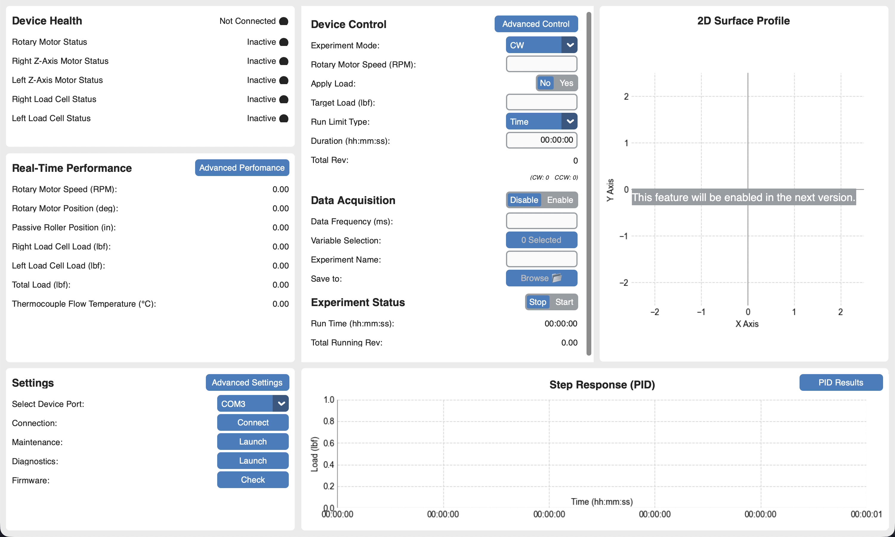

# Fabric Contamination Device (FCD)

Desktop control application for the Fabric Contamination Device — a laboratory instrument developed by **NexGenPPT @ Iowa State University** that runs repeated, controlled rotational and load-application cycles on a fabric sample.

A rotary motor drives a roller that moves the sample, while two Z-axis motors, each paired with a load cell, press against the sample and hold a target contact load using closed-loop (PID) control. While a test runs, the device reports motor speed and position, applied load, and flow temperature back to this application.



## What this repo contains

| Path | Description |
|---|---|
| `application/` | Python/CustomTkinter desktop GUI (`main.py` entry point) |
| `application/controller/` | Arduino firmware (`controller.ino`) for the RP2040-based controller board |
| `application/tools/` | Bundled `arduino-cli` used by the app to compile/flash firmware from the GUI |
| `figures/` | Screenshots used in this README and the user manual |
| `user_manual.tex` / `user_manual.pdf` | Full user manual covering installation, every panel/setting, and troubleshooting |

## Features

- **Live device health & performance** — connection status, motor/load-cell readings, and real-time plots streamed from the controller over USB serial.
- **Experiment control** — configure experiment mode (`CW`, `CCW`, `CW+CCW`, `CCW+CW`, `Swing`), target load, rev-per-cycle, and run limits, then start/stop runs from the **Device Control** panel.
- **PID load control** — closed-loop control of contact load via the Z-axis motors, with a dedicated PID tuning/results view and surface plotting of run data.
- **Advanced control & settings** — manual jogging, homing, and low-level tuning parameters (speeds, ramp lengths, load-cell calibration, PID gains) exposed through **Advanced Control** / **Advanced Settings** dialogs, importable/exportable as JSON.
- **Data export** — record experiment results to an Excel workbook (via `openpyxl`) for later analysis.
- **Diagnostics & logging** — timestamped application/controller event log (`diagnostics.json`), viewable from the **Diagnostics** panel.
- **Firmware management** — compile and push the controller firmware (`controller.ino`) to the device directly from the GUI using the bundled `arduino-cli`, without leaving the app.

See `user_manual.pdf` for a full walkthrough of every panel and setting, with screenshots.

## Requirements

- Python 3.10+ (developed/tested against CPython 3.14)
- A connected FCD controller board (RP2040 / Adafruit Feather CAN) over USB
- Python packages:
  ```
  customtkinter
  pyserial
  matplotlib
  mplcyberpunk
  numpy
  openpyxl
  requests
  ```

Install them with:

```bash
pip install customtkinter pyserial matplotlib mplcyberpunk numpy openpyxl requests
```

## Running from source

```bash
cd application
python main.py
```

On launch the app shows a splash screen, then the main window with three columns: **Device Health / Performance / Settings** on the left, **Device Control** and **Surface** plotting in the middle/right, and **PID** tuning across the bottom. Use the **Settings** panel to select a serial port and connect to the controller.

## Building a standalone app (PyInstaller)

Packaging commands (macOS `.app` + installer `.pkg`, and Windows variants) are documented in [`application/command.md`](application/command.md). Example (macOS, onedir/windowed):

```bash
pyinstaller --noconfirm --onedir --windowed \
  --name FCD \
  --hidden-import=mplcyberpunk \
  --collect-all mplcyberpunk \
  --add-data "data:data" \
  --add-data "controller:controller" \
  --add-data "tools:tools" \
  ./main.py
```

## Controller firmware

The controller firmware lives in `application/controller/controller.ino` and targets the `rp2040:rp2040:adafruit_feather_can` board via [`arduino-cli`](https://github.com/arduino/arduino-cli/releases). It can be compiled and flashed from the app's **Firmware** panel, or manually:

```bash
arduino-cli compile --fqbn rp2040:rp2040:adafruit_feather_can controller
arduino-cli upload -p /dev/tty.usbmodem101 --fqbn rp2040:rp2040:adafruit_feather_can controller
```

## Documentation

- [`user_manual.pdf`](user_manual.pdf) — installation, connecting to the controller, every panel/setting, running a typical experiment, and troubleshooting.

## Authors

Developed by **Mehmet B. Sefer** and **Zi Ying Cheah**, with contributions from **Mitchell Strobbe**, for NexGenPPT @ Iowa State University.
Project led by Mehmet B. Sefer (Dec 2024 – Apr 2026); ongoing efforts led by Zi Ying Cheah since April 2026.
